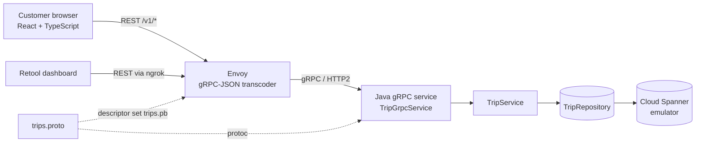
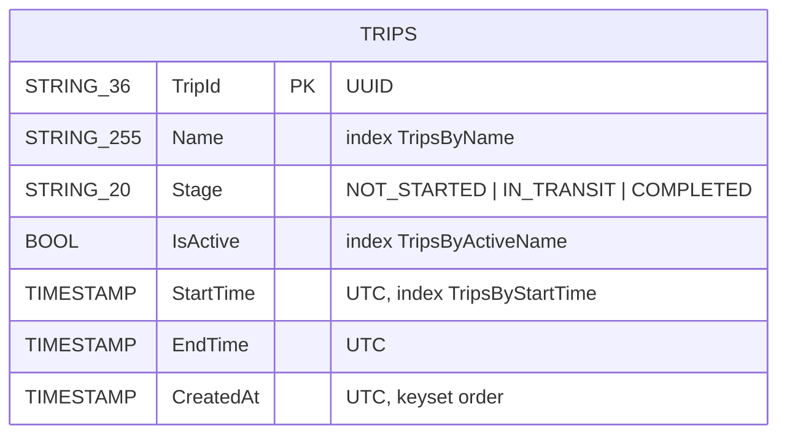
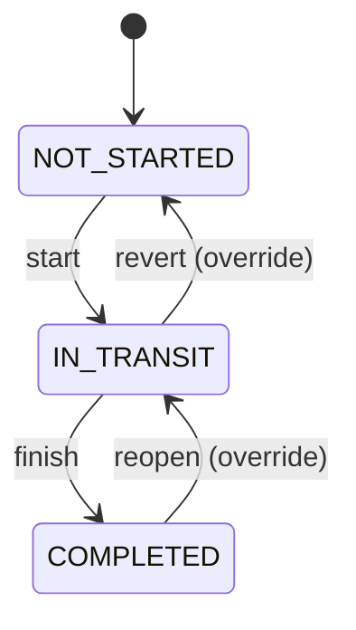
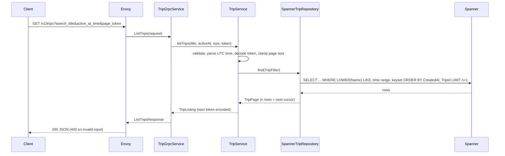
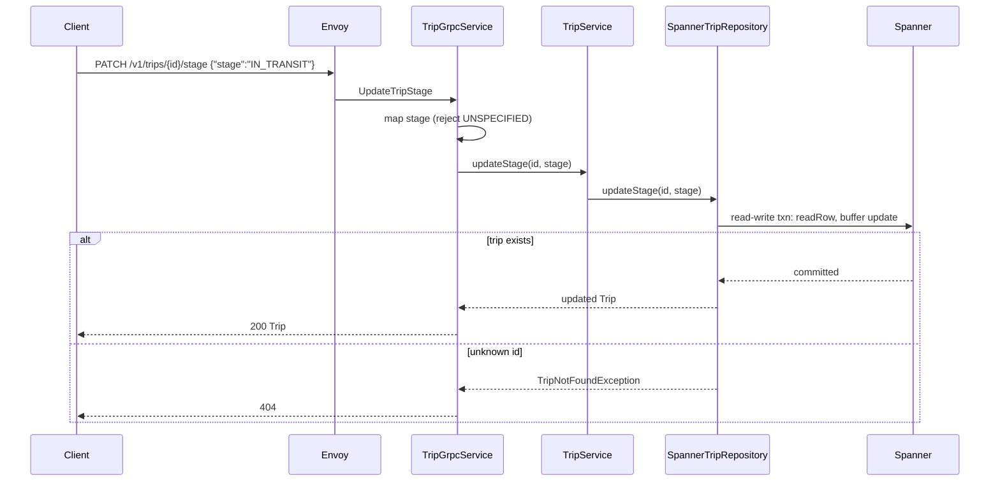
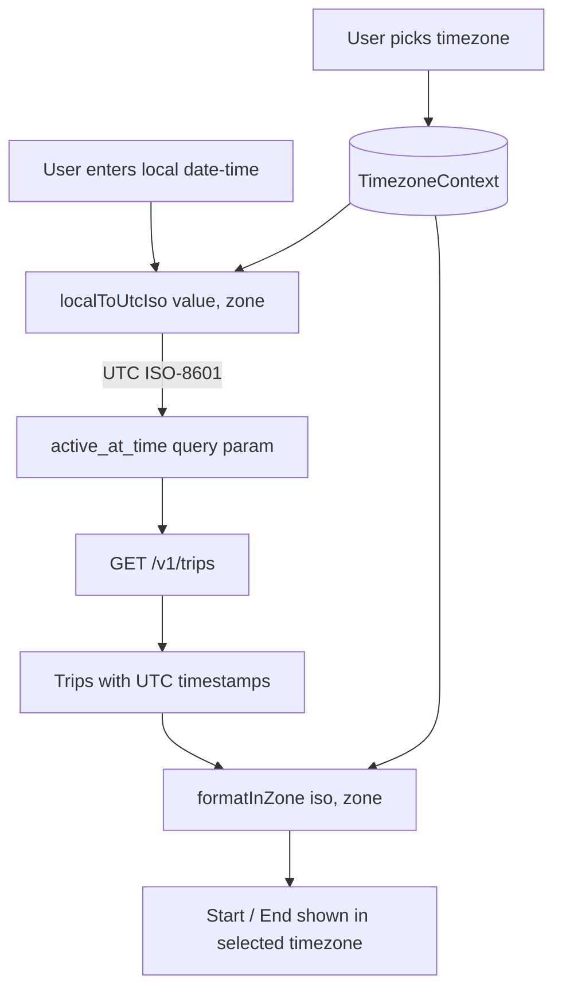
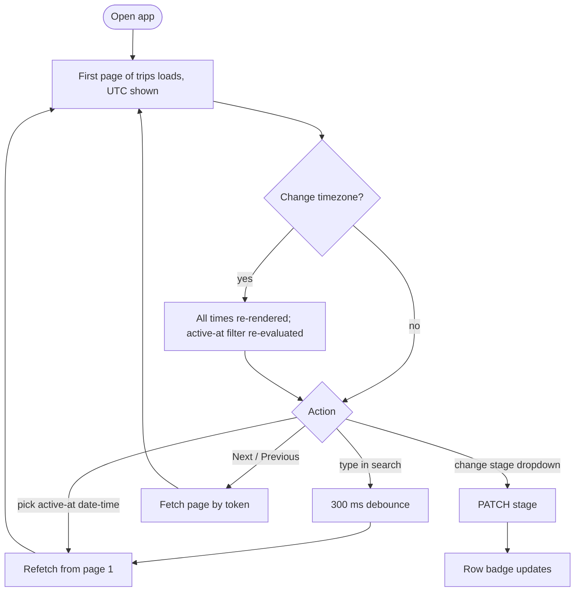
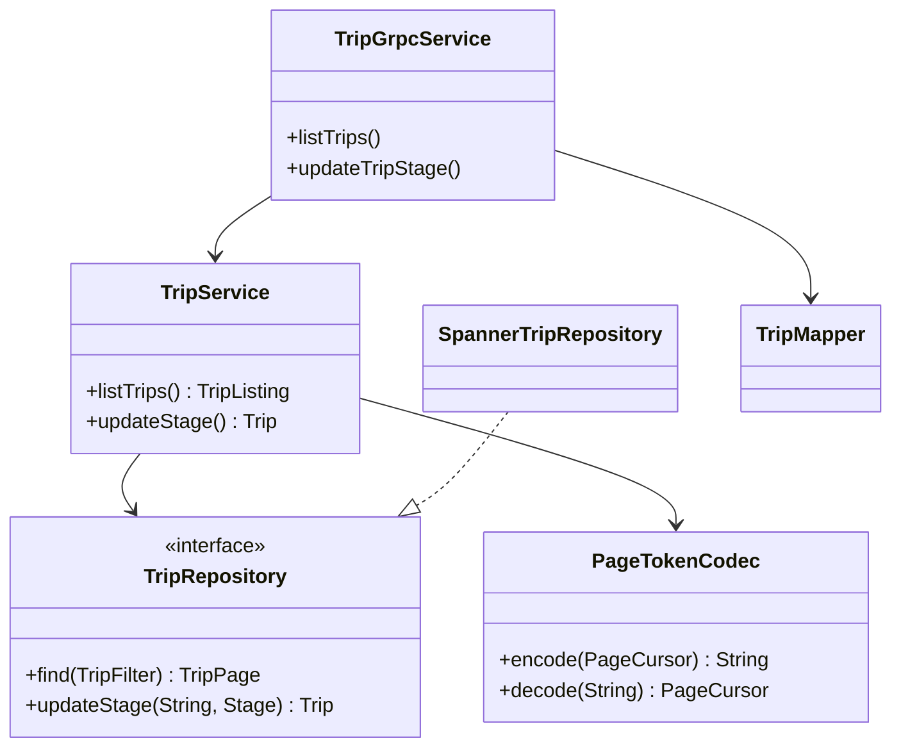

# Diagrams

Mermaid diagrams (render on GitHub or in the VS Code Markdown preview).

## 1. Architecture

## 2. Entity

## 3. Stage lifecycle

Any stage can be set to any other (operations can override); the usual flow is:

## 4. API flow: ListTrips

## 5. API flow: UpdateTripStage

## 6. Timezone flow (frontend)

## 7. Customer user flow

## 8. Backend structure

